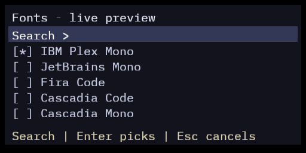
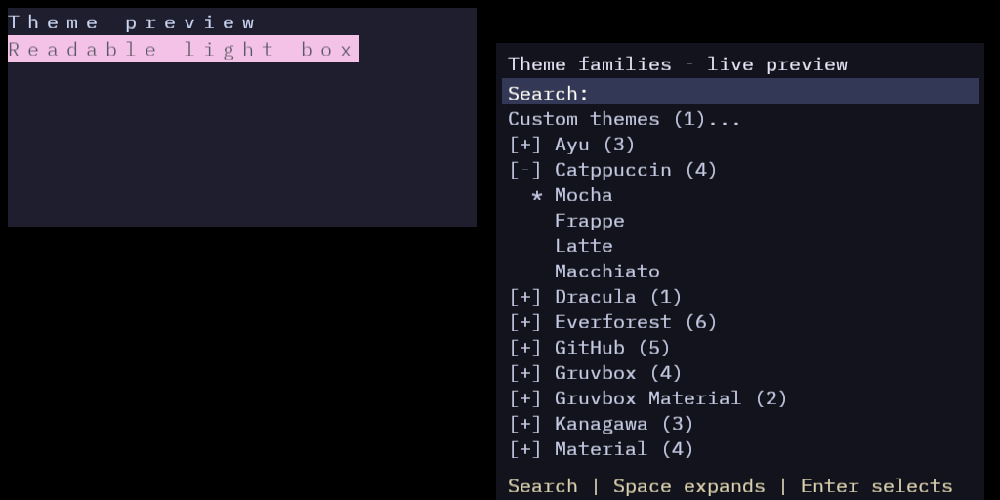

<p align="center">
  
</p>

<h1 align="center">Juna Terminal</h1>

<p align="center">A native Windows terminal with an original Rust VT engine.</p>

Juna is a terminal first: responsive shell input, ordered output, readable text and a clear
foundation for a future developer workspace. It is currently ready for interactive testing.

## What works today

- Windows PowerShell and Command Prompt sessions through ConPTY, with clean shell-exit handling.
- An original VT parser and screen engine, scrollback, alternate screen, Unicode clusters and font fallback.
- GPU rendering, local selection, copy/paste, keyboard input and terminal mouse reporting.
- Catppuccin Mocha by default, 60 starter themes grouped into families, and custom themes saved locally.
- Independent terminal tabs with mouse controls, keyboard switching and per-session shutdown.
- Separate tab/terminal context menus, named tabs and confirmation before middle-click closes.
- Optional terminal-row numbers, theme favourites and bulk expand/collapse controls for families.
- Right-click options with searchable theme/font previews and automatically saved preferences.
- 15 bundled monospace fonts; IBM Plex Mono remains the default. Windows font installation is not required.
- An embedded application icon and a dedicated Windows taskbar application identity.



## Build and run

Requirements: Windows, Rust 1.97 or newer with the Windows GNU toolchain, and a GNU compiler
toolchain that includes `windres` on PATH. Set `WINDRES` to its executable path if needed.
MSVC resource builds remain future work.

```powershell
cargo build --release --bin juna
.\target\release\juna.exe
```

PowerShell is the default shell. To use Command Prompt:

```powershell
.\target\release\juna.exe --shell cmd.exe
```

Pass shell arguments after `--`; they retain their individual argument boundaries.

## Controls

| Action | Control |
|---|---|
| Options | Right-click |
| New tab | Ctrl+Shift+T, plus button, or right-click the tab strip |
| Close tab | Ctrl+Shift+W or right-click its tab |
| Middle-click a tab | Confirm Close tab, or Cancel |
| Rename a tab | Right-click its tab → Rename tab |
| Line numbers | Settings → Show line numbers |
| Switch tabs | Ctrl+Tab / Ctrl+Shift+Tab or click a tab |
| Options while a terminal app owns the mouse | Shift+right-click |
| Copy selection | Ctrl+Shift+C |
| Paste | Ctrl+Shift+V or Shift+Insert |
| Scroll history | Mouse wheel or Shift+PageUp / Shift+PageDown |
| Increase font size | Ctrl++ or Ctrl+= |
| Decrease font size | Ctrl+- |
| Reset font size to 16 px | Ctrl+0 |
| Resize with the mouse | Ctrl+mouse wheel |
| Adjust the font-size setting | Left/Right arrows on its row |
| Enter an exact font size | Click its row or press Space/Enter; accepts px or pt |
| Close Settings | Close or Esc |
| Cancel an unfinished numeric/font hover preview | Esc or Cancel |
| Transfer settings | Settings → Import settings / Export settings |

Font size is limited to 8–40 px. Explicit choices and arrows/zoom save immediately, including
inside Settings. Hovering a font/theme stays temporary; numeric typing previews until Enter/Apply.
Closing Settings keeps confirmed changes and discards an unfinished preview. No separate Save
settings step is required. Import validates JSON and reviews the changes before applying them.

## Fonts and themes

Bundled fonts: IBM Plex Mono, JetBrains Mono, Fira Code, Cascadia Code, Cascadia Mono,
Source Code Pro, Iosevka, Inconsolata, Roboto Mono, Ubuntu Sans Mono, Space Mono, PT Mono,
DM Mono, Victor Mono and Monaspace Neon. Installed monospace fonts are also listed.

Original font licenses and pinned sources are retained in [assets/fonts](assets/fonts/manifest.json).
Bundled notices are also written to `%LOCALAPPDATA%\Juna\font-licenses.txt`. Fourteen families
use SIL OFL 1.1; Ubuntu Sans Mono uses Ubuntu Font Licence 1.0.

Theme families include Catppuccin (all four variants), Dracula, Tokyo Night, Gruvbox and Nord.
Custom → Open themes folder opens `%LOCALAPPDATA%\Juna\themes`. Add native Juna theme JSON
or a single Windows Terminal scheme object; family subfolders group downloaded themes.
The Custom menu discovers changes while open, and offers create, edit, duplicate and recoverable
removal. Invalid files are preserved and reported. Preferences use versioned JSON. Theme export is planned.

Click a theme's yellow star to save it in Favourites; this does not select the theme. Keyboard
users can focus a theme, press Right to focus its star, then Space/Enter to toggle it and Left
to return. Favourites survive cancelled appearance previews. Expand all/Collapse all manage
family lists at once; Collapse all also clears the search that would otherwise expand matches.

Line numbers label retained terminal rows, including wrapped rows, rather than shell commands
or source-file lines. They follow each tab's scrollback, reset with cleared/evicted history, and
stay out of clipboard copies. Full-screen alternate buffers hide Juna's gutter and regain its width.



## Testing and project documents

```powershell
cargo check
cargo clippy --all-targets
cargo test
cargo test --test render_acceptance -- --ignored --test-threads=1
cargo test --test window_acceptance -- --ignored --test-threads=1
```

The last two commands require a real GPU and an interactive Windows desktop.
[TERMINAL_TESTING.md](TERMINAL_TESTING.md) records acceptance evidence and remaining human checks.
Full bidi/contextual text layout, image protocols and a Unix process backend remain unsupported.

- [Architecture](ARCHITECTURE.md)
- [Decisions and dependency provenance](DECISIONS.md)
- [Changelog](CHANGELOG.md)
- [Contribution rules](AGENTS.md)

Juna bundles Junafetch: run `junafetch` or its shorter alias `fetch` without installing
Fastfetch. The compact report shows eight local hardware/session statistics and omits
personal and network identifiers. Use `fetch --plain`, `fetch --json`, or
`fetch --logo full` for other presentations. Terminal-wide privacy and deliberate
hover reveal remain planned work.

See the [roadmap](ROADMAP.md) for tiled terminals, privacy and bundled tools.

