# Testing the repaired terminal

The 2026-10-12 audit repair design is approved. This is a working Windows testing milestone,
not a claim of complete developer-grade compatibility. The engine remains Juna's own implementation.

## Launch and controls

Build with `cargo build --release --bin juna`, then run `target\release\juna.exe`.
The default shell is Windows PowerShell 5.1. To test cmd, run
`target\release\juna.exe --shell cmd.exe`. Shell arguments go after `--`, for example
`target\release\juna.exe --shell powershell.exe -- -NoProfile`.
`JUNA_SHELL` remains supported; `JUNA_SHELL_ARGS` now respects quoted argument boundaries.

Space, Ctrl-C, Ctrl-L, Enter, Backspace, Delete, Insert, navigation keys, modifiers, and F1–F12
are encoded explicitly. The shell interprets `exit`; the single terminal window closes after
the actual child exits and its transport threads finish. Nested programs own their own input.

Drag left to select, Ctrl+Shift+C to copy, Ctrl+Shift+V or Shift+Insert to paste.
Right-click opens Copy/Paste/Select All/Themes/Settings. Wheel or Shift+PageUp/PageDown navigates
history. Typing returns to live output.
Hold Shift to use local mouse selection/scrolling while a TUI has enabled mouse reporting.
Shift+right-click opens Juna's menu when a TUI owns mouse input.
Multiline unbracketed paste sends line endings to the shell, so use clipboard content you intend
to execute. Bracketed-paste-aware programs receive the matching start/end delimiters.

Diagnostics are written to `%LOCALAPPDATA%\Juna\juna.log`; startup/session failure also displays
a Windows error dialog. `RUST_LOG=info` includes adapter, presentation and lifecycle evidence.
The latest launch replaces that log; copy it before starting another diagnostic run.

## Themes and settings

The default is **Catppuccin Mocha**, with **IBM Plex Mono** as the preferred font. The 20 choices
and their source links are listed in THEME_DESIGN.md. Theme selection changes the display live;
the shell is not restarted. Truecolor backgrounds chosen by a prompt are preserved, while the
contrast setting makes unreadable nominal foregrounds darker or lighter as needed.

Open Themes from right-click, type to search, navigate with arrows, and choose with Enter/click.
Hovering previews a theme; Escape restores the saved selection. Open Settings to edit font family,
font size (8–40), or minimum contrast (1–21). Click a field, type or Ctrl+V a replacement, and press
Enter to save. Missing font families fall back to an installed monospace face and log the actual
selection. A contrast value of 1 disables foreground adjustment.

Create a custom theme from the selector or edit the current theme from Settings. Built-ins are
duplicated; existing custom themes can be edited in place. Click a name/color field, enter a name
or `#RRGGBB`, and use Ctrl+S/Save. Invalid values are reported and are not saved. Escape/Cancel
discards the draft and restores the saved palette. Settings are in `%LOCALAPPDATA%\Juna\settings.json`;
custom palettes are in `%LOCALAPPDATA%\Juna\themes`. Files use versioned JSON with portable palette
fields; VS Code export is not implemented yet.

## Automated acceptance commands

```
cargo check
cargo clippy --all-targets
cargo test
cargo test --test render_acceptance -- --ignored
cargo test --test window_acceptance -- --ignored
```

The last two tests require an interactive Windows desktop, a graphics backend, and system fonts,
so ordinary Cargo test lists them as ignored. They must be explicitly executed on the target host.
They do not use shell prompt matching or inject operating-system keystrokes.

The GPU test compares row pixels before and after editing the next row and captures
`target\acceptance\render.ppm`. The window test opens the actual winit application separately
with cmd and PowerShell, verifies presented frames and real exit codes, and writes isolated logs
under `target\acceptance\<shell>\Juna\juna.log`. These are synthetic test data, not user sessions.

## Verification matrix

| Area | Evidence | Status |
|---|---|---|
| Space/control/modifier/dead-key encoding | Pure exact-byte tests, including AltGr, keypad and mouse modes | Verified in this session |
| Row corruption, CR/wrap, large parameters, ED, insert/delete, resize, wide pairs | Permanent regression fixtures and chunk-boundary equivalence | Verified in this session |
| Real process lifecycle | cmd and PowerShell tail markers, nonzero exit and joined workers | Verified in this session |
| Byte integrity and process-tree teardown | Existing transport/ConPTY acceptance suite | Verified in this session |
| GPU row isolation and text | Pixel comparison and captured render frame | Verified in this session |
| Window presentation and natural exit | Vulkan on RTX 3060; cmd exit 0 and PowerShell exit 7 | Verified in this session |
| Physical typing, Ctrl-C in an interactive program | Human smoke checklist below | Pending human review |
| Clipboard ownership/paste in the real UI | Platform integration plus pure paste encoding; no OS clipboard test performed | Pending human review |
| Mixed DPI, minimize/restore, surface/device disruption | Code paths present; no multi-monitor/failure injection run | Pending human review |
| Real editor and pager | Input/mode/alternate-screen fixtures; no editor/pager session recorded | Pending human review |

The first window test failed because inherited `RUST_LOG=warn` hid its evidence lines. The test
now explicitly sets `RUST_LOG=info`; both shell cases passed on rerun. This was a test-environment
failure, not a presentation failure. Previous audit failures remain recorded in AUDIT.md.

A later repeat caught the reader-first shutdown race, which is corrected and covered by a
deterministic test. Earlier green runs alone did not prove that interleaving. The final standard
suite has 165 passes, and the two desktop/GPU acceptance tests are run separately.

## Human smoke checklist

1. Type a command containing spaces, edit it with arrows/Home/End/Delete/Backspace, and execute it.
   Repeat near the right edge and after enough output to scroll. Watch the row above the input.
2. Run a long-lived process, interrupt with Ctrl-C, and confirm a usable prompt returns.
3. Print accented text, CJK, emoji, colored text, and box drawing; compare the captured sample.
4. Drag/select/copy and paste one line, then multiple lines in a bracketed-paste-aware program.
5. Scroll back while new output arrives. Return to live output by typing. Resize small/large,
   minimize/restore, and move across monitors with different scaling.
6. Run an installed editor and pager; check alternate-screen restoration, cursor hide/show,
   navigation, mouse reporting and exit. Record application/version, observed bytes if available,
   screenshots and the diagnostic log for a failure.
7. Type `exit` in each shell, and close during heavy output. Confirm no orphan process survives.

## Explicit remaining scope

OSC 52 clipboard is denied. Graphics protocols, panes/editor/drawer features, and the Unix PTY
backend are deferred. Full bidi layout and cross-cell contextual shaping are not implemented;
current shaping handles each stored grapheme cluster. Fonts can still lack a requested glyph,
which is recorded as a miss. The atlas has a finite per-frame capacity and reports exhaustion;
it no longer permanently blacklists a glyph because an earlier frame filled it.

This evidence supports further interactive testing. It does not replace the human checklist or
claim all existing Tier 2 requirements have shipped. DX12/GLES presentation is not verified by the
Vulkan result. No benchmark or universal compatibility claim is made.

## Recorded render sample

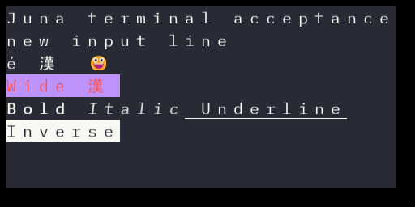

## Theme follow-up evidence — 2026-10-12

The GPU tests now verify palette bytes on both sRGB and non-sRGB surfaces; the previous test
covered only the latter and missed double encoding. Before the correction, Dracula's `[40,42,54]`
background rendered as `[110,113,127]` on the sRGB path. Both target formats now preserve it.
Twenty theme backgrounds and actual menu-overlay drawing were captured and checked. The real
window received an end marker after 300 output rows with theme/settings panels open, then closed
when the shell exited. An initially incorrect test command delayed every loop iteration; explicit
grouping fixed that fixture, and both menu cases passed.

Final theme iteration: 176 standard tests pass, plus three explicitly run GPU tests and two
explicitly run window tests. Check/clippy are warning-free, and the release executable was rebuilt.

Custom storage tests cover round trips, replacement saves, corrupt/unsupported/duplicate records,
read-only settings preservation, and cancellation without changing engine cells. These are automated
code/GPU/window checks. Hands-on mouse/clipboard/IME/mixed-DPI review remains the human checklist.

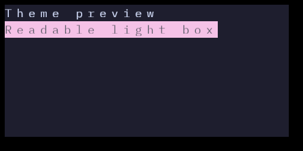
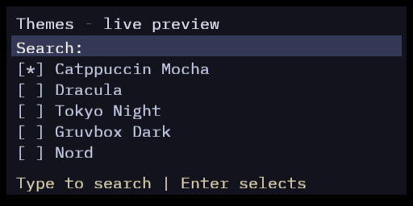
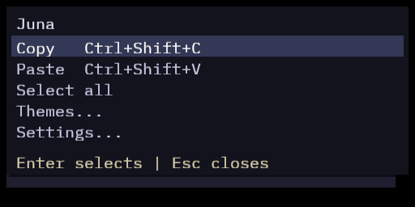
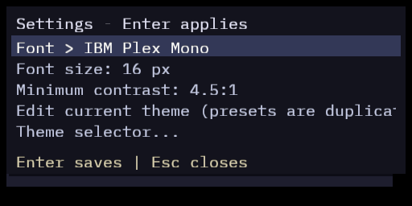
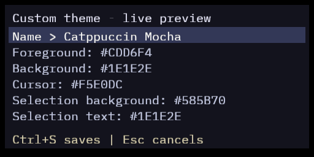

## Application title and Fastfetch — 2026-10-12

Verified: installed Fastfetch 2.69.0 ran in PowerShell through the production ConPTY/engine
path with OS/CPU/GPU/Memory output, a success marker, exit 0 and zero dropped bytes.
The test refreshed its process PATH from registered Windows machine/user values because
the parent session had an older PATH. Launch Juna from a fresh Windows session if
fastfetch is not found; Fastfetch is installed on this host, not bundled with Juna.
Verified title regression: both real shell windows presented frames, retained Juna Terminal after explicit shell title changes, and closed on shell exit. Check/clippy, all 176 standard tests and both explicit real-window tests passed in this iteration.

## Bundled fonts and sizing — 2026-10-13

Verified: 180 standard tests, check/clippy, four explicit GPU tests and two explicit real-window
tests pass. All fifteen faces resolve in an empty font database; the GPU samples exercise regular
weight, ASCII disambiguation, box drawing/CJK fallback and row clipping. Sizes 8/16/40 render.
Font/setting cancellation, saved selection, zoom bounds, AltGr exclusion, pixel-wheel accumulation
and stored sizing are covered. The real window keeps output flowing with a font picker open.

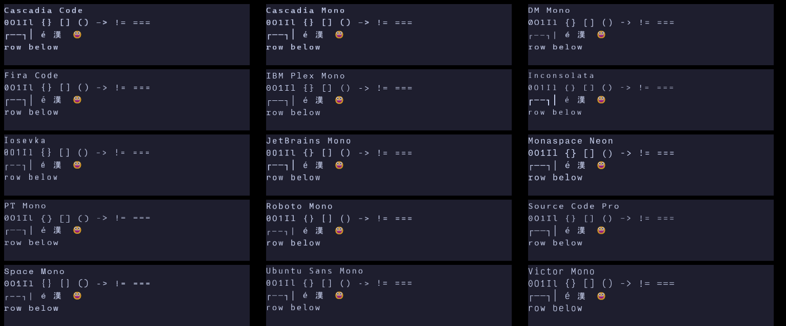


Verified taskbar evidence: embedded ICO images match the approved source; native small/big icon
handles exist; Windows accepts the dedicated application ID. The observed user window started
before that identity build. Explorer's displayed icon after relaunch still needs human confirmation.

## Right-side preview and taskbar — 2026-10-13

Verified: right-edge geometry follows viewport resize; GPU comparison leaves the left 480 pixels
unchanged in a 1024-pixel frame. Required gates pass (180 tests) and both real-window cases pass.
A direct release EXE starts, presents, configures relaunch icon properties and exits 0. Native
small/large icons and all seven embedded resource images are verified. Explorer initially retained
a generic group icon despite valid resources; a fresh explicit group with relaunch properties
shows the Juna dog, confirmed by the user. The permanent release setup was visually inspected.
The unsuccessful Rust borrowed-variant attempt is recorded in DECISIONS.md, including its repair.

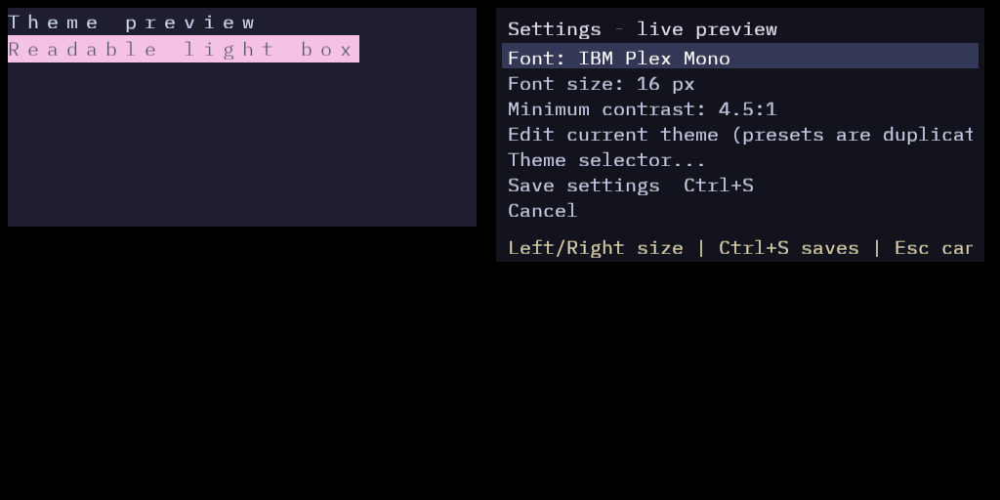

## Tabs, numeric prompts and theme families — 2026-10-13

Verified: check/clippy, 185 standard tests, four GPU cases, three real-window cases and release
build pass. The byte-exact ConPTY coverage remains passing. Concurrent startup tabs consume their
independent output markers and reap without closing surviving sessions. Overlays leave shell
output flowing, and the final session closes the window. The actual release presents and exits 0;
all seven embedded icon images match the approved source. Reviewed captures cover grouped families,
Custom management, numeric entry and tab presentation. UI tests cover Space, Escape, caret editing,
point conversion and saved/cancelled previews. Theme worker tests cover discovery, mapping,
bounded input, generation results and byte-preserving trash/restore.

Retraction/limits: the first restricted filesystem run failed Clippy configuration access and seven
filesystem-dependent tests. Normal-access rerun passed. Incremental hard-link fallback warnings
were emitted; they are build-cache warnings, not source lints. These automated UI/window checks
do not replace hands-on keyboard/mouse/IME and mixed-DPI review. No Junafetch privacy or updater
acceptance is claimed at this milestone.

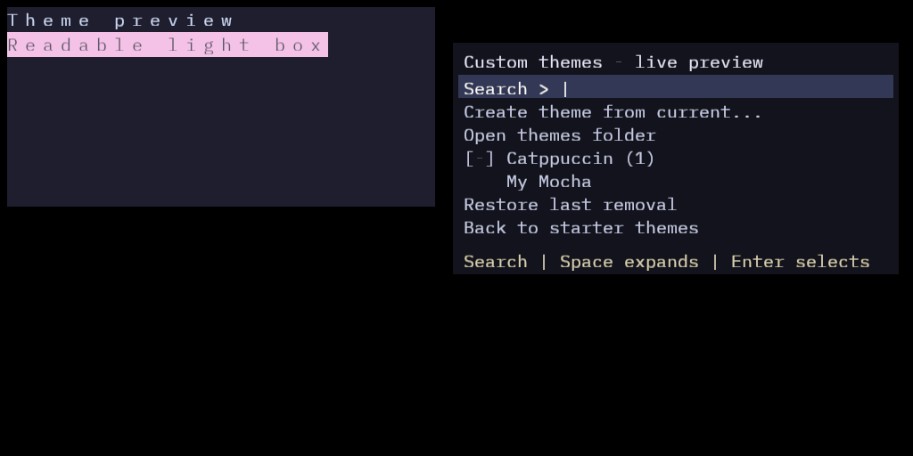
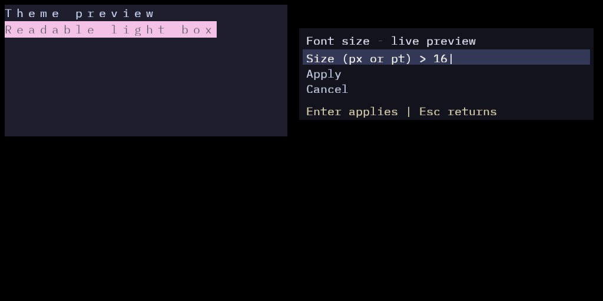
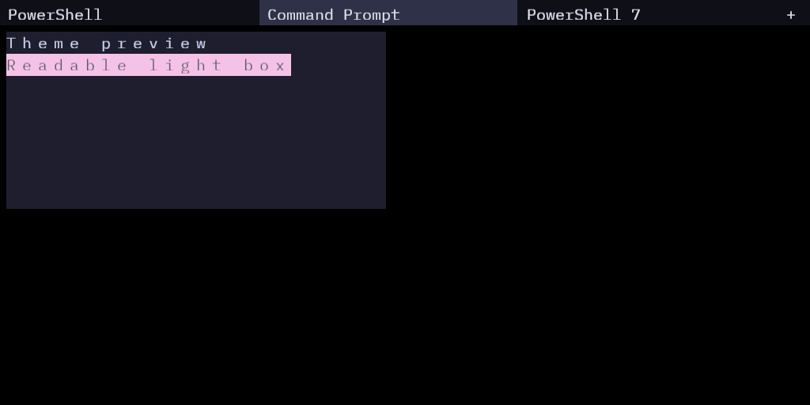
